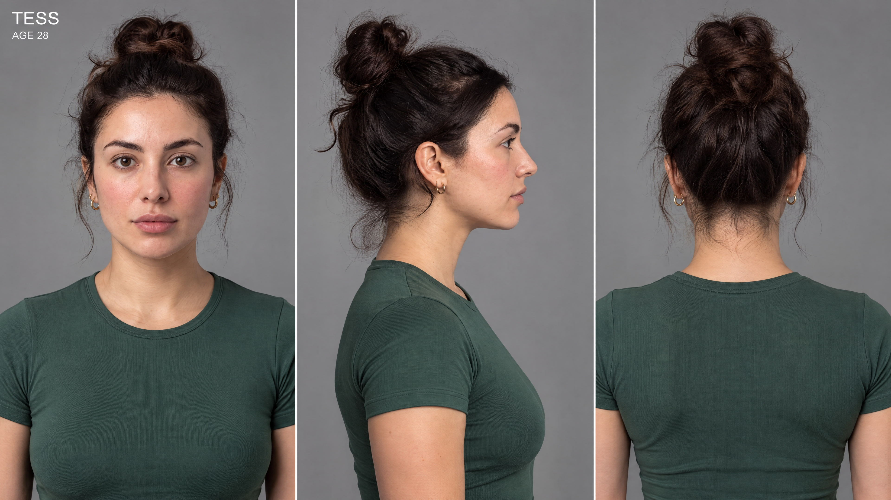
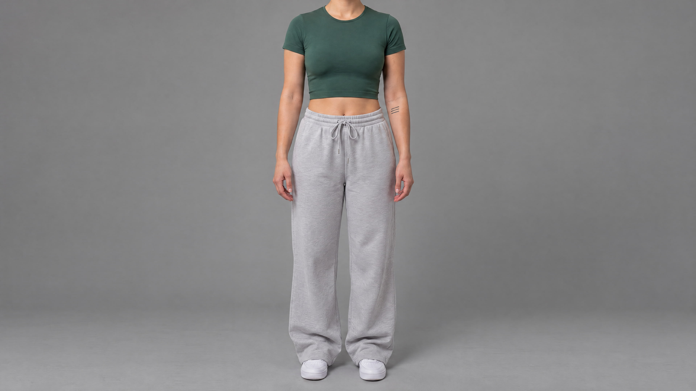
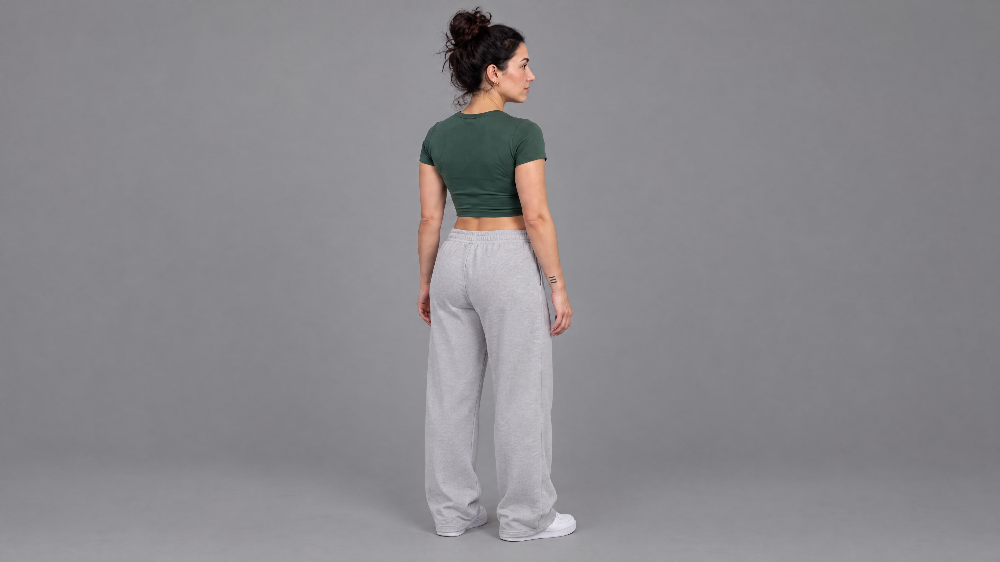
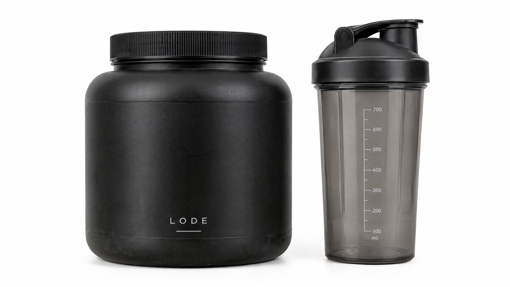
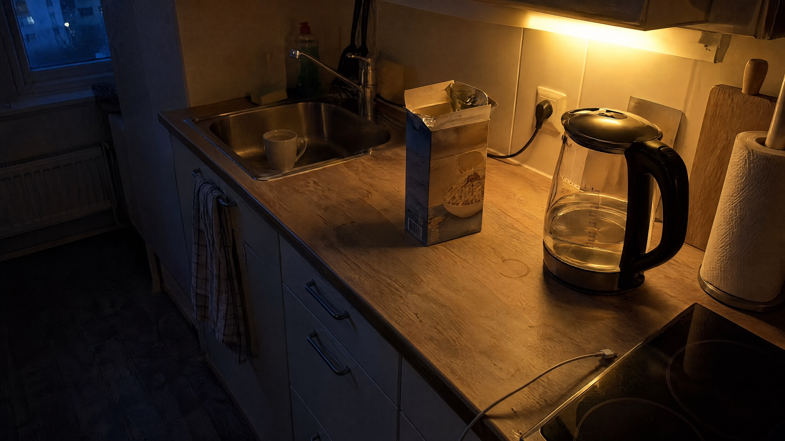
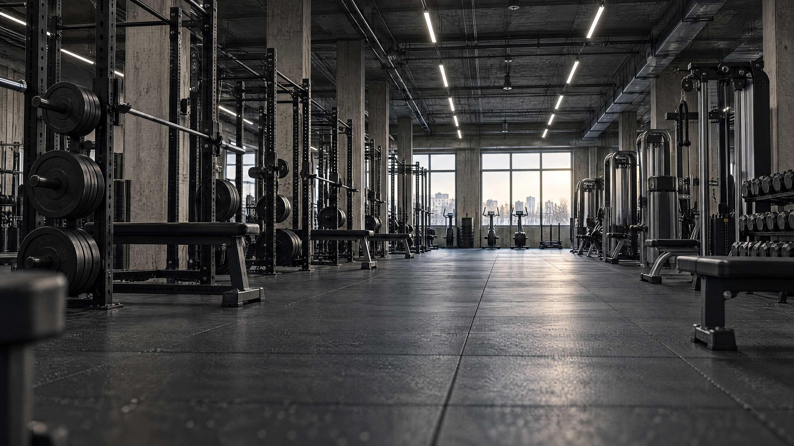
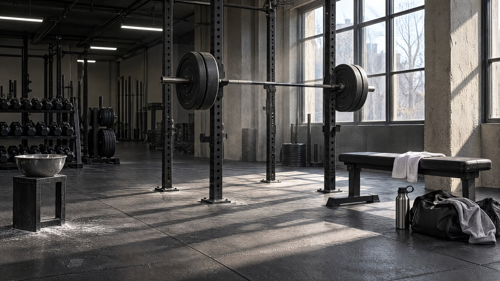

# Tess / LODE Protein — AI UGC Ad

A 30-second AI-generated UGC-style product review for a fictional protein powder brand (LODE). Persona: Tess, 28, fitness creator. Tone: low energy, dry, genuine — not influencer-polished.

▶️ [Watch the finished video](https://lnkd.in/p/dXEZhci9)

> This is a production archive for humans. The skill in `skills/ai-filmmaker/` does not load it and never copies these prompts. It teaches the craft behind them instead.

---

## Pipeline at a glance

```
BRIEF         Low-energy fitness persona reviewing protein powder
              Locations: apartment kitchen (pre-dawn) + industrial gym

SCRIPT        Hook → action shot → out the door → arrival (Block A)
              Chalk and load → the set → proof → verdict → close (Block B)

IMAGES        Tess character sheet (Nano Banana Pro, from a written description)
              LODE product reference (white background)
              Kitchen plate (tungsten vs cold blue window light)
              Gym wide establishing plate
              Gym filming bay plate (hard diagonal window light)

VIDEO         Seedance 2.5, omni_reference, 9:16, 1080p, 15 s per block
              Block A: 0:00–0:15
              Block B: 0:15–0:30 (Block A's last frame attached)

EDIT          CapCut — blocks assembled, native audio kept, no music
```

Full block prompts: [prompts-seedance.md](./prompts-seedance.md)

---

## Reference images

### Character — chest-up turnaround (front / profile / back)


### Character — full-length front, headless (deliberate)


### Character — full-length rear three-quarter, head visible


### Product reference — LODE tub + shaker


### Location plate — apartment kitchen, pre-dawn


### Location plate A — gym wide (establishing)


### Location plate B — gym filming bay


---

## Key decisions — why they were made

**No music.** UGC authenticity lives in silence and room tone. Music signals "ad."

**Phone-shot look, not cinematic.** The whole film is framed as self-recorded content. Hard directional daylight in the gym works as a practical key: the cinematography is real, it just looks like someone propped their phone well.

**Low-energy performance.** Talking to her phone like she's talking to a friend. No enthusiasm, no smiling at the lens. The more understated, the more credible.

**Two location plates, one gym.** Plate A is the wide establishing shot for her arrival. Plate B is the filming-bay corner where she actually records, with the window daylight doing real work as a key light.

**Product reference as its own image.** The LODE tub and shaker get their own reference so Seedance can match the product exactly in close-ups instead of reinventing it.

---

## Notes for people studying these prompts

These prompts were written before the skill's conventions were written down. The skill now standardises a few things this production did differently:

- **Character sheet.** Tess's identity was built as a chest-up turnaround, plus the full-length panels generated as separate images. The skill teaches the three-panel headless sheet as the primary method and keeps this turnaround as a tested alternative.
- **Style DNA.** Each block here has its own `LOOK:` section, and Block B's is a shortened rewrite of Block A's. The skill now asks for one Style DNA pasted byte-identical as the last section of every block, and `validate_blocks.py` enforces it.
- **Names.** These prompts write "Tess @Image1" and sometimes "Tess" alone. The skill allows a name only attached to its @Image tag.
- **Voiceover over action** (the scoop, the chalk shots) is allowed because it's labelled "Voiceover, no lip sync". That rule came from this production.
- **Micro-cuts.** Several segments hold two or three quick cuts. The skill keeps every timestamped segment at 2 s or more, and labels fast cuts inside one as a montage.
